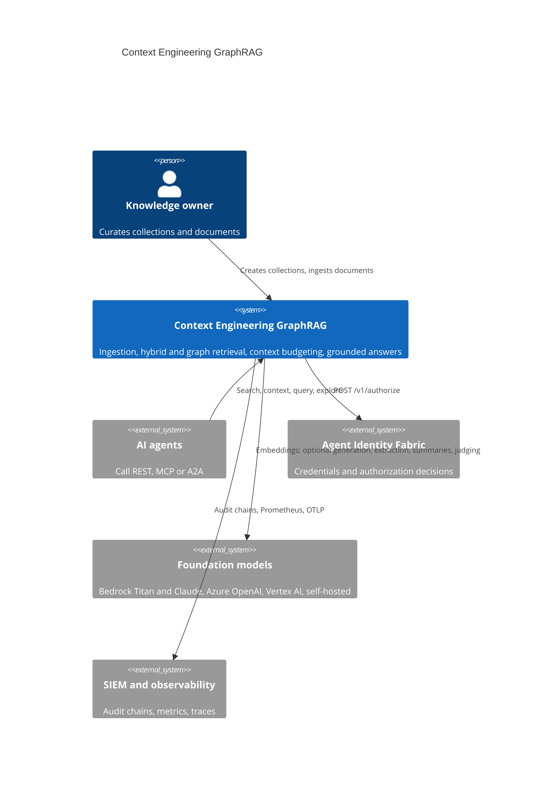
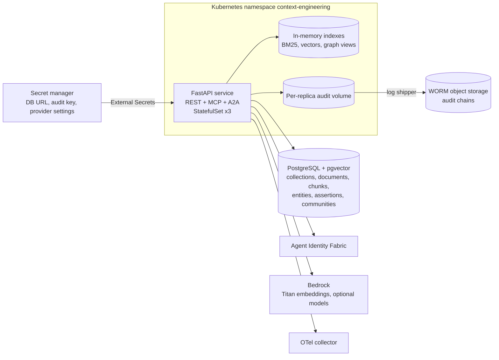
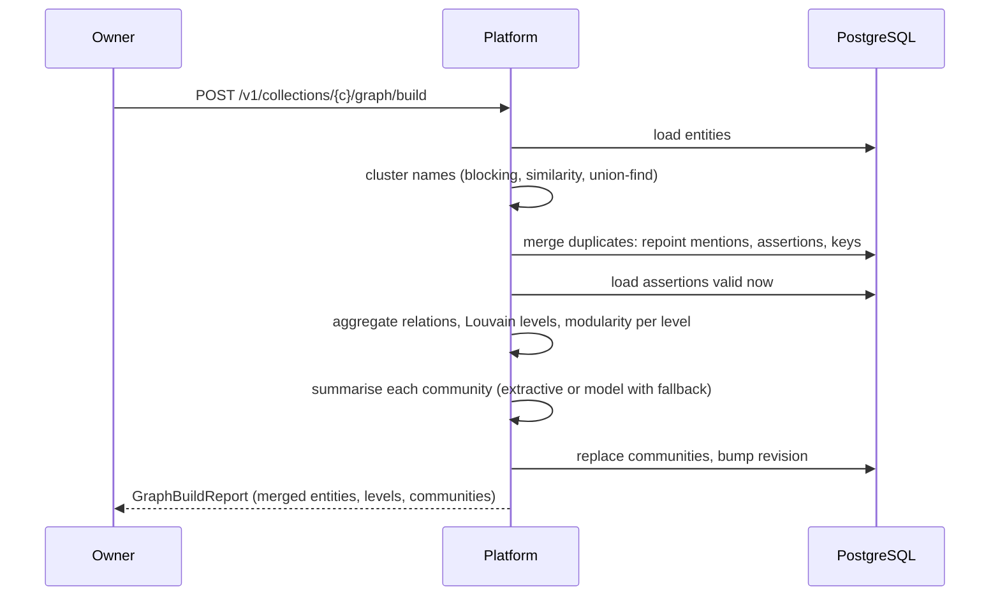
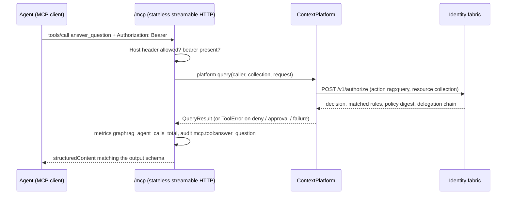
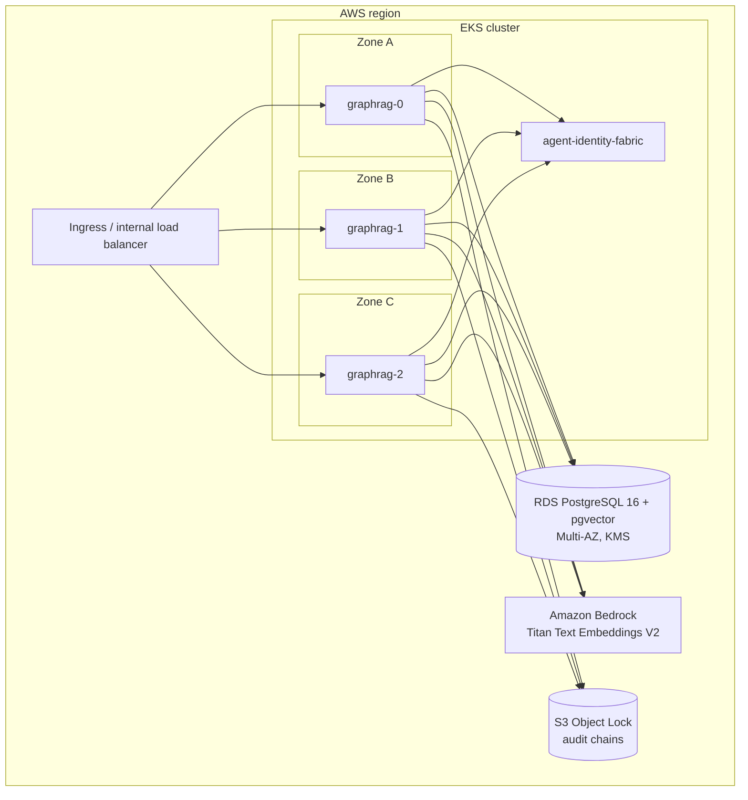

# Architecture

## Business problem

Enterprise agents fail less often because the model is weak than because the
context is wrong: the passage that answers the question is not retrieved, the
retrieved text is stale or superseded, the relationship that matters spans
three documents, the prompt is filled with near-duplicates, or a poisoned web
page smuggles instructions into the context window. When an agent then acts on
an answer, nobody can show which source supported which sentence.

This platform treats context as an engineered, governed artifact. It decides
what an agent sees (hybrid and graph retrieval), how much (token budgeting),
from which version of the truth (temporal validity), and whether the result
may be released (groundedness and policy), and it records the evidence for
every one of those decisions.

## System context (C4 level 1)



## Containers (C4 level 2)



## Components (C4 level 3)

| Package | Modules | Responsibility |
|---|---|---|
| `api` | `app`, `routes`, `mcp`, `a2a` | HTTP contract, OAuth-style error bodies, correlation IDs, request metrics; MCP server mounted at `/mcp`; Agent Card and JSON-RPC `message/send` |
| `application` | `service.ContextPlatform`, `knowledge_graph.KnowledgeGraph` | Use cases; authorization of every call; audit of every decision and state change; graph views, build pipeline, neighbourhoods |
| `orchestration` | `workflow.AgenticRetrievalWorkflow` | Query screening, planning, iterative retrieval, candidate assembly, budgeting, generation, groundedness evaluation, release decision |
| `ingestion` | `chunking.Chunker`, `service.IngestionPipeline` | Chunking strategies, injection quarantine, secret redaction, embedding, extraction, incremental entity resolution, versioned assertions |
| `embeddings` | `hashing.HashingEmbedder`, `providers.BedrockTitanEmbedder`, `providers.OpenAICompatibleEmbedder` | Embedder implementations behind the `Embedder` port |
| `retrieval` | `bm25`, `fusion`, `rerank`, `hybrid` | Okapi BM25, reciprocal rank fusion, MMR, lexical and hosted cross-encoders, revision-aware hybrid retriever |
| `graph` | `extraction`, `resolution`, `community`, `summarize`, `search` | Entity and relation extraction, entity resolution, Louvain, community summaries, temporal aggregation, personalised PageRank, community ranking |
| `context` | `budget` | Compression, de-duplication, section budgets, provenance-carrying context packs, spotlighted rendering |
| `generation` | `answer` | Extractive and model-backed attributed answer generators |
| `evaluation` | `groundedness`, `retrieval_metrics` | Claim-level groundedness (lexical or model judge); recall, precision, MRR, nDCG |
| `security` | `authorization` | `FabricAuthorizer`, `LocalAuthorizer`, `JwtVerifier`, JWKS resolvers |
| `integrations` | `identity_fabric` | Typed client for `/oauth2/token`, `/oauth2/introspect`, `/v1/authorize` |
| `infrastructure` | `database.SqlStore` | SQLAlchemy Core persistence (PostgreSQL in production, SQLite in tests), optional pgvector table, erasure cascade |
| `observability` | `metrics.PlatformMetrics` | Prometheus registry and metrics |
| `runtime` | `container` | Composition root built from `Settings` |

## Sequences

### Ingestion

```mermaid
sequenceDiagram
  participant A as Agent or owner
  participant P as Platform
  participant F as Identity fabric
  participant E as Embedder
  participant D as PostgreSQL
  A->>P: POST /v1/collections/{c}/documents
  P->>F: authorize rag:document.write on collection (classification)
  F-->>P: allow (audited)
  P->>P: digest; unchanged version? return "unchanged"
  P->>P: redact credentials, chunk with offsets, screen each chunk for injection
  P->>E: embed non-quarantined chunks
  P->>P: extract entities and relations, resolve against blocking-key candidates
  P->>D: one transaction: close previous assertions (valid_to), replace chunks and mentions, insert assertions, bump revision
  P-->>A: IngestResult (version, chunks, quarantined, redacted, assertions)
```

### Agentic query

```mermaid
sequenceDiagram
  participant A as Agent
  participant P as Platform
  participant R as Hybrid retriever
  participant G as Knowledge graph
  participant M as Generator
  participant J as Groundedness judge
  A->>P: POST /v1/collections/{c}/query
  P->>P: authorize rag:query; screen query (injection, credentials)
  P->>G: graph view as_of; link query entities
  P->>P: plan: local, global or passages
  P->>R: BM25 + dense, RRF, rerank, MMR
  alt query terms poorly covered
    P->>R: second round with aliases and feedback terms, fuse rounds
  end
  P->>G: local search (personalised PageRank) or rank community summaries
  P->>P: compress, de-duplicate, budget sources S/F/C
  P->>M: generate with citations
  P->>J: judge every claim against its cited sources
  P->>P: policy answer:release (groundedness, contradictions, citations, classification)
  P-->>A: answered / abstained / withheld / pending_approval (audited)
```

### Graph build



### MCP tool call



## Temporal model

Relations are stored as assertions: one per relation stated by one document
version, with `valid_from` (the version's `effective_at`) and `valid_to`
(the document's `expires_at`, or the `effective_at` of the next version that
supersedes it). Ingesting a new version closes the old assertions instead of
deleting them, so `as_of` queries (`ContextRequest.as_of`, the neighbourhood
`as_of` parameter) see what was known at that instant, and current queries
see only open assertions. Assertions keep the evidence sentence, so
historical facts remain explainable after their chunks have been replaced.
Chunk retrieval applies the same rule: a document is retrievable only between
its `effective_at` and `expires_at`. Erasure is the exception: it removes
assertions of the erased document entirely (ADR-0006).

## Index consistency

Every write that changes what retrieval can see increments the collection
`revision` in the same transaction. Each replica caches, per collection, a
BM25 index, an embedding matrix and the current graph view together with the
revision they reflect. Before serving a request the retriever reads the
revision (one primary-key lookup) and rebuilds if another replica wrote in
the meantime. Index terms are computed once at ingestion and stored with the
chunk, so a rebuild does not re-tokenize. With `GRAPHRAG_VECTOR_BACKEND=pgvector`
dense search runs in PostgreSQL against an HNSW cosine index (ADR-0003).

## Deployment view



Replicas spread across zones (topology spread constraints); the PDB keeps two
available during voluntary disruption; the database runs Multi-AZ. Bedrock is
reached with IRSA credentials restricted to the approved model ARNs.

## Data

| Store | Data | Classification | Retention |
|---|---|---|---|
| `collections` | Name, classification, owner, revision, embedding model | INTERNAL | Life of collection |
| `documents`, `chunks` | Current version text, offsets, digests, embeddings, index terms, quarantine flags | Collection classification (up to RESTRICTED) | Until superseded or erased |
| `entities`, `entity_keys`, `mentions` | Entity names, aliases, blocking keys, mention offsets | Collection classification | Until erased (orphans removed) |
| `assertions` | Relations with evidence sentence and validity interval | Collection classification | Historical versions kept; erased with their document |
| `communities` | Community members and summaries | Collection classification | Rebuilt on graph build; dropped on any erasure |
| Audit chains | Who did what, under which policy; digests, never query text | CONFIDENTIAL | 7 years, WORM |
| Audit signing key | Ed25519 private key | SECRET | Rotated with the change process |

Queries and answers are stored only as SHA-256 digests in the audit chain.

## MCP integration

The MCP server uses the official `mcp` SDK (`MCPServer`), mounted at `/mcp`
in stateless streamable-HTTP mode with JSON responses, so any replica can
serve any call. Six tools are registered (`search_passages`, `build_context`,
`answer_question`, `explore_entity`, `evaluate_groundedness`,
`ingest_document`); their input and output schemas are the same Pydantic
models as the REST API. Each call:

1. requires a bearer credential (requests without one get 401 before the MCP
   layer) and a `Host` header in `GRAPHRAG_PUBLIC_URL` /
   `GRAPHRAG_ADDITIONAL_HOSTS` (DNS-rebinding protection);
2. is authorized by the same platform use case as REST (identity fabric or
   local policy), so scopes and classification ceilings apply unchanged;
3. increments `graphrag_agent_calls_total{protocol="mcp"}` and writes an
   `mcp.tool:<name>` audit event; failures return MCP tool errors carrying
   the platform error code.

Read-only tools are annotated `read_only_hint=True`; `ingest_document` is
annotated idempotent and non-destructive.

## A2A communication

`GET /.well-known/agent-card.json` publishes `protocolVersion` 0.3.0, name,
description, `url` (`<public url>/a2a`), `preferredTransport` JSONRPC,
version, provider, capabilities (no streaming, no push notifications), input
and output modes, two skills (`grounded-answer`, `context-pack`) and a bearer
`securitySchemes` entry for agent-identity-fabric credentials.

`POST /a2a` accepts JSON-RPC 2.0 `message/send`. The text parts form the
question; message or params `metadata` names `collection`, `skill`, `mode`,
`k` and `purpose_of_use`. The result is a `Task` with a text artifact (the
released answer) and a data artifact (citations, groundedness, release
decision); a withheld answer yields task state `rejected`. Errors: -32700
parse, -32600 invalid request, -32601 unknown method, -32602 invalid params,
-32004 unsupported operation (`message/stream`, `tasks/resubscribe`,
push-notification config), -32005 no text part, -32000 platform errors with
`data.error` set to the platform code. Missing credentials are rejected with
HTTP 401.

## Observability

| Signal | Name |
|---|---|
| HTTP latency by route and status | `graphrag_http_request_duration_seconds` |
| Pipeline stage latency (`graph.load`, `retrieve`, `graph.local`, `graph.global`, `budget`, `generate`, `evaluate`, `search`) | `graphrag_stage_duration_seconds` |
| Answers by disposition and mode | `graphrag_answers_total` |
| Groundedness distribution | `graphrag_answer_groundedness` |
| Context tokens per pack | `graphrag_context_tokens` |
| Ingested and quarantined chunks | `graphrag_ingested_chunks_total`, `graphrag_quarantined_chunks_total` |
| Authorization decisions by source | `graphrag_authorization_decisions_total` |
| Index rebuild time | `graphrag_index_reload_seconds` |
| Graph builds | `graphrag_graph_builds_total` |
| MCP and A2A calls | `graphrag_agent_calls_total` |

Traces: FastAPI instrumentation exports OTLP spans when
`GRAPHRAG_OTLP_ENDPOINT` is set; model calls add GenAI semantic-convention
attributes through the agentic-core telemetry observer. Logs are JSON with a
`correlation_id` taken from `X-Correlation-ID` (or generated) and echoed in
responses and audit events. Alerts are in `configs/prometheus/alerts.yaml`
(multi-window burn rate, latency, groundedness, withheld answers, quarantine
spikes, deny spikes, replica count); the dashboard is
`configs/grafana/context-engineering-graphrag.json`.

## CI/CD

`.github/workflows/ci.yml` runs on every push and pull request:

| Job | Gates |
|---|---|
| `quality` (Python 3.12 and 3.13) | ruff, black, mypy `--strict`, bandit, contract drift, all test suites with 90% coverage |
| `integration-postgres` | PostgreSQL 16 with pgvector service container; integration tests must run, not skip |
| `deploy-artifacts` | Helm lint and render, required-values failure check, kubeconform, Terraform fmt and validate for AWS, Azure, GCP, Trivy configuration scan |
| `container` | Image build, smoke test (readiness, Agent Card, 401 on REST and MCP, metrics, uid 10001), Trivy image scan, Syft SBOM, Grype gate |
| `semgrep` | Python, secrets and Dockerfile rules |

`.github/workflows/release.yml` runs on `v*.*.*` tags: the quality gate,
version consistency between tag, package and chart, image build and push to
GHCR with SBOM and provenance attestation, Helm chart push to GHCR OCI, and a
GitHub release carrying the SBOM and image digest.

## Deployment pattern

Terraform provisions the database, key management, secret store, WORM audit
storage, workload identity and model access per cloud. External Secrets syncs
the database URL, audit key and provider settings into the namespace. The
Helm chart renders a StatefulSet (per-replica audit volumes), Services, PDB,
HPA, NetworkPolicy (ingress from agent namespaces, ingress controller and
monitoring; egress to DNS, PostgreSQL, HTTPS, OTLP and in-cluster services),
optional Ingress and ServiceMonitor, and refuses to render without the
deployment-specific values.

## Cloud reference implementation

AWS is the primary deployment; the same chart runs on AKS and GKE.

| Concern | AWS (primary) | Azure | GCP |
|---|---|---|---|
| Kubernetes | EKS | AKS | GKE |
| Database | RDS for PostgreSQL 16, Multi-AZ, forced TLS, pgvector | PostgreSQL Flexible Server, zone-redundant HA, `azure.extensions=VECTOR` | Cloud SQL PostgreSQL 16, regional, encrypted-only connections |
| Encryption keys | KMS key with rotation | Key Vault (premium, purge protection) | Cloud KMS key ring, 90-day rotation |
| Secrets | Secrets Manager | Key Vault secrets | Secret Manager |
| Audit storage | S3 Object Lock (compliance mode) | Storage account with immutability policy | Bucket with retention policy (optional lock) |
| Workload identity | IRSA role | User-assigned identity with federated credential | Service account with Workload Identity |
| Model access | `bedrock:InvokeModel` on approved foundation models and inference profiles | `Cognitive Services OpenAI User` on a given account | `roles/aiplatform.user` |

## Cost and scalability

- **Ingestion** pays for embeddings: one embedding call per non-quarantined
  chunk, so cost follows corpus size and chunk size. Re-ingesting an
  unchanged document is a no-op (digest comparison).
- **Queries** with the default extractive generator, pattern extractor,
  extractive summaries and lexical judge make no model calls beyond one query
  embedding. Each model-backed feature adds model calls: one per chunk for
  extraction, one per community for summaries, one per answer, one per cited
  claim for the model judge.
- **Memory per replica** for the in-process vector index is about
  chunks x dimensions x 4 bytes (float32) plus the BM25 postings; 1024-dimension
  Titan vectors take 4 KiB per chunk. `GRAPHRAG_VECTOR_BACKEND=pgvector` moves
  the nearest-neighbour search into PostgreSQL (HNSW) so query cost stops
  growing linearly with the collection; replicas still hold the embedding
  matrix for MMR re-ranking, so memory per replica is the planning limit
  (ADR-0003).
- **Horizontal scaling**: replicas share nothing but PostgreSQL; the HPA
  scales on CPU and caches converge through the revision check. Graph builds
  are explicit operations, so their cost is scheduled, not per query.
- The token budget (`BudgetPolicy.max_tokens`) bounds what each model call
  can consume.

## Acceptance criteria

| Criterion | Verified by |
|---|---|
| Chunks are exact slices of the source with token limits and overlap | `tests/unit/test_text_and_chunking.py` |
| Hybrid ranking follows BM25, RRF and MMR definitions | `tests/unit/test_embeddings_and_ranking.py` |
| Entity resolution merges acronyms and legal-suffix variants, not incompatible types | `tests/unit/test_graph.py::TestResolution`, `tests/unit/test_platform.py::test_graph_build_merges_aliases` |
| Louvain recovers planted communities | `tests/unit/test_graph.py::TestCommunities` |
| A new document version closes old assertions; `as_of` sees history | `tests/unit/test_platform.py::test_new_version_closes_old_assertions`, `tests/integration/test_postgres.py` |
| Expired documents drop out of retrieval | `tests/unit/test_platform.py::test_expired_documents_drop_out` |
| Context packs never exceed the budget and carry provenance | `tests/unit/test_context_generation_evaluation.py::TestBudget`, `tests/unit/test_workflow.py::test_context_pack_respects_budget` |
| Ungrounded, contradicted or falsely cited answers are withheld; weakly grounded restricted answers wait for approval | `tests/unit/test_workflow.py` |
| Unanswerable questions abstain | `tests/unit/test_workflow.py::test_unanswerable_question_abstains` |
| Injected content is quarantined and never reaches context; credentials are redacted | `tests/security/test_threats.py` (T6, T8) |
| Erasure removes chunks, vectors, mentions, assertions, orphaned entities and community summaries | `tests/unit/test_platform.py::test_erasure_cascade` |
| Every call is authorized; scopes, classification ceilings, purpose of use and delegation limits are enforced | `tests/unit/test_authorization.py`, `tests/security/test_threats.py` |
| Dependencies failing fail closed; replicas see each other's writes | `tests/chaos/test_dependency_failures.py` |
| REST, MCP and A2A lifecycle works end to end; no input causes a 5xx | `tests/e2e/` |
| The audit chain verifies and detects tampering; it contains no query text | `tests/unit/test_platform.py::test_audit_chain_is_signed_and_free_of_query_text`, `tests/security/test_threats.py::test_t11_audit_tampering_is_detected` |
